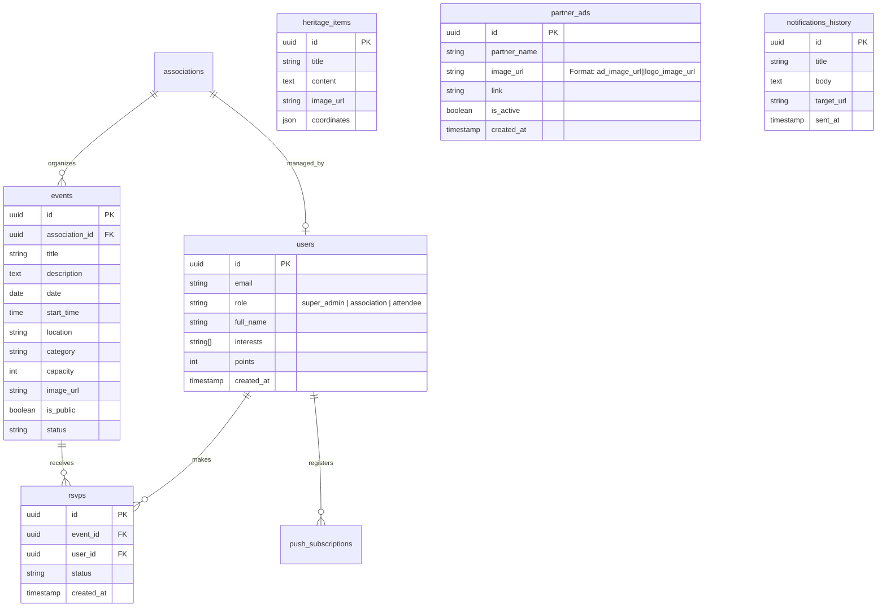

# 📋 تقرير شامل عن مشروع: منصة «تواصل صحراء» (Ouarjlane Connect Pro)

---

### 📌 رسالة تمهيدية لـ Claude (Context & Instructions for Claude)
> **مرحباً Claude،**
> هذا ملف تقرير تقني ومعماري شامل لمنصة **«تواصل صحراء | Sahara Gather Connect» (Ouarjlane Connect Pro)**. المنصة حية وتعمل حالياً بالكامل. أرجو قراءة التقرير لفهم المكدس التقني، البنية المعمارية، الميزات المكتملة، والتحديات المطروحة، ثم تزويدي بالاستشارات والتطويرات المطلوبة في نهاية التقرير.

---

## 1. نبذة عامة عن المشروع (Executive Summary)

* **اسم المنصة:** تواصل صحراء (Sahara Gather Connect / Ouarjlane Connect Pro).
* **الموقع الجغرافي والسياق:** ولاية ورقلة (وارجلان) وحوض حاضرة سدراتة الأثرية، جنوب الجزائر.
* **الهدف والرؤية:** 
  منصة رقمية موحدة وتطبيق ويب تقدمي (PWA) يربط الجمعيات الثقافية والاجتماعية والرياضية بالمواطنين والزوار. تهدف المنصة إلى:
  1. تسهيل تنظيم واستكشاف الفعاليات المحلية.
  2. توفير نظام حجز فوري وتذاكر إلكترونية برمز QR مع إمكانية العمل بدون اتصال بالإنترنت (Offline Mode).
  3. أرشفة التراث المعماري والثقافي لحوض سدراتة والقصر العتيق عبر خريطة فضائية حية بالأقمار الصناعية.
  4. دعم الرعاة والشركاء المحليين بنظام إعلاني ذكي متقدم.
* **الهوية والتصميم:** 
  نمط صحراوي تراثي فاخر (*Sahara Luxury Palette*):
  - اللون الأساسي الداكن: البني الصحراوي العميق `#301809`.
  - اللون الذهبي المتوهج: العنبري `#efa83f`.
  - درجات البيج الرملي: `#fae1b7` و `#d4b174`.
  - دعم كامل للغة العربية (RTL) وخطوط مخصصة (IBM Plex Sans Arabic و Thmanyah).

---

## 2. المكدس التقني الكامل (Full Tech Stack)

| الطبقة (Layer) | التقنيات المستخدمة | التفاصيل والوظيفة |
| :--- | :--- | :--- |
| **واجهة المستخدم (Frontend)** | **React 18/19 + TypeScript** | واجهات تفاعلية سريعة ومكتوبة بنمط Strict Typing لضمان خلوها من الأخطاء. |
| **أداة البناء (Build Tool)** | **Vite** | سرعة فائقة في التطوير والبناء (Hot Module Replacement)، وتوليد حزم الإنتاج المدمجة. |
| **التصميم والتنسيق (UI & Styling)** | **Tailwind CSS + Radix UI + Lucide** | تصميم متجاوب (Mobile-first)، متوافق مع كافة أحجام الشاشات مع مكونات Shadcn UI وأيقونات Lucide. |
| **الحركات والانتقالات (Animations)** | **Framer Motion** | انتقالات صفحات سلسة وتأثيرات ظهور بطاقات وقوائم احترافية. |
| **الخلفية وقاعدة البيانات (Backend & BaaS)** | **Supabase (PostgreSQL)** | نظام المصادقة (Auth)، قاعدة بيانات علائقية متقدمة، وسياسات حماية البيانات (Row Level Security)، وتخزين الوسائط (Buckets). |
| **تطبيق الويب التقدمي (PWA)** | **VitePWA + Workbox Service Worker** | إمكانية تثبيت المنصة كتطبيق أصلي على أندرويد و iOS، مع كاش متقدم لصور التخزين وخرائط الأقمار الصناعية. |
| **إدارة التذاكر الرقمية (Ticketing Engine)** | **qrcode.react + react-to-print** | توليد باركودات QR عالية الدقة مشفرة لمعرف التذكرة والفعالية، مع طباعة فورية أو حفظ بصيغة PDF. |
| **نظام الخرائط ونظم المعلومات (GIS Mapping)** | **Leaflet + Esri World Imagery** | عرض خريطة حية فضائية للأقمار الصناعية مع إحداثيات موثقة لمعالم ورقلة وقصر سدراتة. |
| **الإشعارات (Push Notifications)** | **Web Push API + Service Worker** | إرسال إشعارات البث العام (Broadcast) إلى هواتف ومتصفحات المشتركين مباشرة من لوحة الإدارة. |

---

## 3. أدوار المستخدمين وصلاحيات الوصول (User Roles & RBAC)

المنصة تعتمد نظام التحكم في الوصول القائم على الأدوار (Role-Based Access Control) بثلاثة مستويات:

### 1. الزائر / المشارك (Attendee & Guest)
* استكشاف دليل الفعاليات والبحث السريع حسب الفئة (تراثي، ثقافي، ديني، تعليمي، رياضي).
* الحجز الإلكتروني الفوري بضغطة زر.
* الحصول على تذكرة QR إلكترونية وحفظها تلقائياً في «مخزن التذاكر بدون إنترنت» (`Offline Ticket Vault`).
* إمكانية الدخول التجريبي الفوري بنقرة واحدة (Demo Quick Login ⚡) أو الدخول عبر الرابط السحري (Magic Link).
* لوحة تحكم خاصة تضم الفعاليات المسجلة، نظام شارات التفاعل (Gamification Badges)، ومتابعة النقاط.

### 2. ممثل الجمعية / المنظم (Association Manager)
* لوحة تحكم خاصة بنشاطات الجمعية (`/association`).
* إنشاء فعاليات جديدة (العنوان، الوصف، التاريخ والوقت، الموقع الجغرافي، السعة القصوى للمقاعد، ملصق الفعالية).
* تعديل الفعاليات القائمة وإدارتها.
* كشف مباشر لأسماء المسجلين وإحصائيات الحضور مع تصدير القوائم كملف CSV.
* طباعة تقرير رسمي منظم للفعالية بضغطة زر لتقديمه للجهات الراعية والإدارية.

### 3. المشرف العام (Super Admin)
* لوحة تحكم شاملة متقدمة (`/admin`).
* إدارة المستخدمين وترقية الأدوار (تحويل مستخدم عادي إلى جمعية أو مشرف).
* إدارة وتوثيق المعالم التراثية في سدراتة وورقلة.
* نظام إرسال إشعارات البث الشامل المباشر (Broadcast Notifications) عبر الـ Push API.
* إدارة إعلانات الشركاء والرعاة بنظام الرفع المزدوج الذكي.

---

## 4. الميزات المبتكرة الحصرية بالمنصة (Key Innovations)

### 1. نظام الرعاة المزدوج الذكي (Dual-Asset Sponsor Engine)
* **المشكلة السابقة:** كانت صور المنتجات (مثل ماكينات الخياطة) تتداخل مع شعار الراعي، مما يفسد مظهر الشريط الشرفي.
* **الحل المنفذ:** تم ابتكار حقلين مستقلين تماماً في لوحة الأدمن:
  - **خانة شعار الراعي (Logo):** تظهر حصرياً وبشكل منفرد كلوغو مفرغ في الشريط الشرفي للرعاة في **الصفحة الرئيسية (`/`)**، وفي حال عدم إدخال شعار يظهر اسم الراعي نصياً فقط دون أي صورة مشتتة.
  - **خانة صورة التخصص أو الإعلان (Ad Photo):** تظهر كصورة عريضة تغطي بنر العروض داخل **لوحة المشارك (`/attendee`)** لعرض نشاط الراعي التجاري (مثل صورة ماكينات الخياطة لشركة Ignatex).
  - يتم تخزين الرابطين في قاعدة البيانات بصيغة مدمجة آمنة (`adUrl||logoUrl`) تعمل تلقائياً دون الحاجة لتعديل جدول البيانات أو المساس بالخدمة الحية.

### 2. مخزن التذاكر التلقائي بدون اتصال (Offline Ticket Vault)
* عند حجز أي تذكرة، يقوم التطبيق بتخزين نسخة رقمية كاملة من التذكرة ورمز الـ QR في الذاكرة التخزينية المحلية للمتصفح (`localStorage`).
* في حال انقطاع تغطية الإنترنت (وهو أمر شائع في المناطق الصحراوية أو داخل القاعات الأثرية)، يستطيع الزائر فتح هاتفه وإبراز تذكرته بالكامل لمنظمي الدخول دون الحاجة لأي اتصال بالشبكة.

### 3. خريطة الأقمار الصناعية ثلاثية الأبعاد التفاعلية (Satellite Heritage Explorer)
* استخدام مصورات Esri الفضائية بدقة وضوح عالية لتمكين الزوار من استكشاف:
  - معالم القصر العتيق بورقلة.
  - مسجد لالة عزة التاريخي.
  - أطلال وبقايا حاضرة سدراتة الأثرية المدفونة تحت الرمال.
* بطاقات منبثقة تفاعلية توفر معلومات تاريخية موثقة وصوراً للموقع.

---

## 5. هيكلية قاعدة البيانات (Database Schema Overview)

---

## 6. استفسارات وتطويرات مقترحة لمناقشتها مع Claude

أبرز النقاط والمحاور التي يُطلب من Claude المساهمة في تطويرها وتوسيعها:

1. **نظام ماسح الـ QR للتحقق عند المداخل (Mobile QR Scanner & Check-in):**
   - تصميم واجهة مخصصة للمنظمين (`/association/check-in`) تستخدم كاميرا الهاتف لمسح تذاكر الحضور والتحقق اللحظي من صحتها ومنع الدخول المكرر لنفس التذكرة.
2. **تدقيق وحماية قواعد البيانات وسياسات RLS (Row-Level Security Hardening):**
   - كتابة سياسات PostgreSQL RLS صارمة تمنع المستخدم العادي من التلاعب بنقاطه (`points`) أو ترقية دوره (`role`) عبر الـ REST API.
3. **التحكم الصارم في السعة والتزاحم (Capacity Concurrency & Race Conditions):**
   - كتابة دالة مخزنة (PostgreSQL Stored Procedure / RPC) تضمن عدم تجاوز سعة الفعالية القصوى (`capacity`) حتى في حال قيام عشرات المستخدمين بالنقر على زر الحجز في نفس الثانية.
4. **تحسين الحزم والأداء (Code Splitting & Bundle Optimization):**
   - اقتراح هيكل لتحميل الصفحات الثقيلة بأسلوب `React.lazy()` و `Suspense` لتسريع تحميل الموقع الأولي للمستخدمين على شبكات الهاتف 3G/4G.
5. **تحسين محركات البحث والمشاركة الاجتماعية (Dynamic OpenGraph & SEO):**
   - آلية لتوليد بطاقات المشاركة الاجتماعية على فيسبوك وواتساب لكل فعالية ببياناتها وصورتها المخصصة.

---
*تم إنشاء هذا التقرير الفني لتوثيق الحالة الحقيقية والمكتملة لمنصة تواصل صحراء.*
